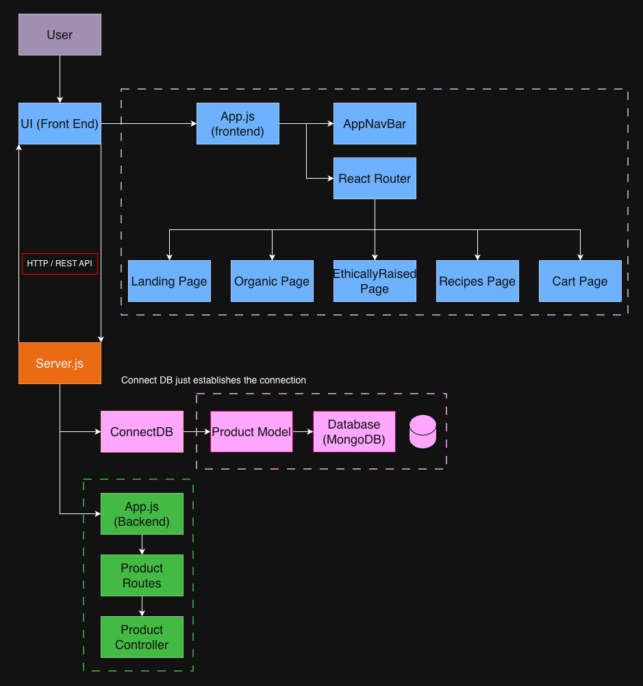
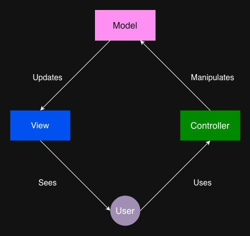

# FreshRoute Architecture
Concise reference for the two diagrams and how the system pieces fit.

## Diagrams
- **System architecture diagram:** user → frontend routing → API → DB.  
  
- **Model–View diagram:** MVC relationship among user, view, controller, and model.  
  

## How It Flows
1) User enters UI (React/Vite) → `App.js` loads `AppNavBar` + `React Router`.
2) Router serves pages: Landing, Organic, EthicallyRaised, Recipes, Cart.
3) Page data requests hit `server.js` over HTTP/REST.
4) Server runs `ConnectDB`, uses the `Product` model, and reads/writes MongoDB.
5) Backend `app.js` registers product routes/controllers and responds back to the UI.

## Where Things Live
- Frontend SPA: `frontend/`
- API + services: `backend/`
- Diagrams (PNGs): `doc/sprint1/documentation/`
